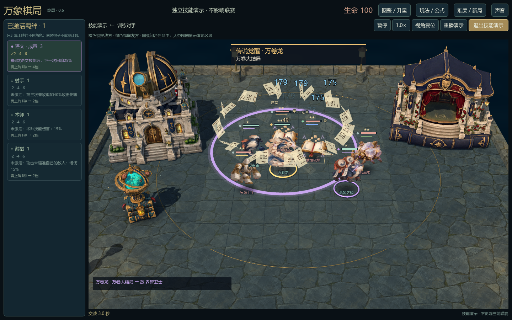
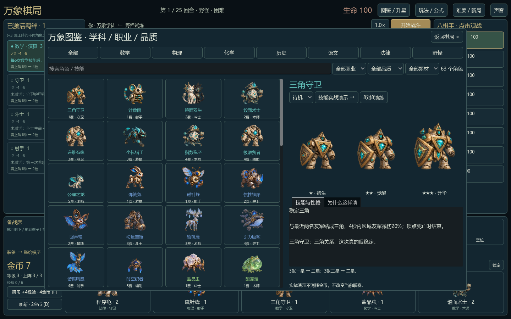

# 万象棋局 · 知识嘉年华

一个把数学、物理、化学、历史、语文、法律变成角色与技能的 Godot 桌面自走棋。知识可以整活：吸来铁皮车、把三只小猪的房子砸下去、在阳台对白中传递护盾。

## 下载试玩

Windows 64 位便携包见 [Releases](https://github.com/cedricxugun/autobattle/releases)。解压整个目录后运行 `万象棋局.exe`，无需额外安装 Godot 或 Node。请保留同目录的 `game` 和 `runtime` 文件夹。



## 0.6 十人口与传说

8名棋手参赛，最高10人口；经验、商店概率和AI同步扩展，联赛上限35轮。每个学科的9名角色按普通/精良/稀有/史诗/传说分为2/2/2/2/1名，商店、图鉴、详情与战场标记明确区分品质。

六张5费卡分别承担群控强化、回卷救场、百分比区域伤害、复活援军、三幕爆发变书和反施法领域。加入独立3D演出、目标范围、可打断蓄力、友敌横幅与释放音效；首次技能时间错开，减少大招同时遮挡战场。

便携包内的“十人口传说演练.cmd”直接进入10对10演示，使用实际战斗数值，不修改联赛存档。图鉴仍可分别测试每个技能。

[具体规则、研究来源与验证结果](docs/endgame-0.6.md)。这不是完全复制DOTA AUTO CHESS；角色仍为2D序列帧，整体美术和全阵容平衡还需要迭代。

## 当前内容

- 54 种棋子、6 个学科、5 档费用、3 个星级，以及 9 种野怪、6 件装备。
- 招募、共享有限卡池、刷新、锁店、升人口、合星、拖拽交换与上下场、装备掉落。
- 最多10人口上阵、35轮上限；玩家与 7 名 AI 的联赛；简单、困难、磨难；独立主场攻防、观战、淘汰和最终排名。
- 学科/职业/品质/文学题材图鉴、独立技能演示、半速及重播、知识线索和来源。
- 实体3D庭院：地面格位与周围步道连为一体；真实观测站、故事剧场和天体仪模型；近端九席备战石座。
- 18件原创技能道具；9个角色重点重做了技能时序和喜剧演出。0.4增加重点投掷技能的贴地目标/进度标记、透视尺寸和视觉中断；未声称所有54个技能重制。
- 敌方在上、我方在下，默认横行水平；透视投影、中键小角度查看场景、滚轮缩放；拖拽落点匹配地面高亮，避免高个子棋子抢占后排点击。

联赛流程完整可玩。角色仍采用 2D 序列帧和程序动作，技能演出的精修程度并不一致；这不是所有角色已达到商业发行品质的声明。0.4已移除整幅背景景片与独立棋盘框，场地和建筑使用真实网格、共同光照及透视；角色仍是3D空间内的2D序列帧。三件建筑/装饰模型均经Tripo网页版生成，天体仪含点击知识提示。



## 从源码运行

目前提供 Windows 64 位开发与运行路径。首次准备会下载固定版本的 Godot 4.7.2 和 Node.js 24.14.0，并核对 SHA-256：

```powershell
powershell -ExecutionPolicy Bypass -File .\setup.ps1
```

之后运行根目录的 `启动万象棋局-Godot.cmd`，或在 Godot 中打开 `godot/wanxiang/project.godot`。

Godot 原生界面与场景负责显示和交互；随附本地 Node 对局模块负责规则模拟，仅监听带会话令牌的 `127.0.0.1` 随机端口。游戏运行不需要联网服务。

## 验证

准备运行环境后：

```powershell
godot\wanxiang\runtime\node.exe godot\wanxiang\backend\test-native.cjs
godot\wanxiang\runtime\node.exe godot\wanxiang\backend\test-endgame.cjs
godot\wanxiang\runtime\node.exe godot\wanxiang\backend\test-presentation.cjs
godot\wanxiang\runtime\node.exe godot\wanxiang\backend\test-comic.cjs
godot\tools\godot-4.7.2\Godot_v4.7.2-stable_win64_console.exe --headless --path godot/wanxiang --max-fps 60 --script res://scripts/test_drag_input.gd -- --qa
```

另有 `test_native.gd`、`test_presentation.gd`，覆盖合星、显示状态、坐标、动画与分类图鉴。测试使用独立 QA 存档。

## 构建便携版

需要 Python 3 和 Windows .NET Framework 的 C# 编译器。先执行 `setup.ps1`，再运行：

```powershell
powershell -ExecutionPolicy Bypass -File .\build.ps1
```

输出位于 `output/`。大型运行程序、Godot 导入缓存和便携压缩包不提交到 Git，便携包作为 Release 附件分发。

## 目录

| 路径 | 内容 |
| --- | --- |
| `godot/wanxiang/scripts` | Godot 界面、角色、特效与交互 |
| `godot/wanxiang/backend` | 战斗、AI、经济、共享卡池和测试 |
| `godot/wanxiang/data` | 角色、知识彩蛋和图集布局 |
| `godot/wanxiang/assets` | 角色动作、场景、技能与道具素材 |
| `godot/*prompts*`、`godot/*prompt.txt` | 内置生图使用的提示词记录 |
| `godot/wanxiang/licenses` | 第三方运行环境许可证 |

完整玩法、实现范围、知识来源和制作说明见 [嘉年华版本说明](godot/嘉年华版本说明.txt)。新美术由内置图像生成工具制作；公开文化题材用于原创游戏改编，现实知识与虚构战斗规则分开说明。
